  

  

  📍 Ho Chi Minh City · 🎓 FPT University (2023 – 2027) ·
  <a href="mailto:duongbilly18012004@gmail.com">📧 Email</a>

---

### 🕹️ About me

I'm **Nguyễn Tùng Dương**, an IT student at **FPT University** focused on **backend development** and system-oriented engineering.
I enjoy solving logical problems, designing clean data structures and building server-side foundations that are stable, secure and scalable.

> *"Great software is built one thoughtful decision at a time."*

### 🏆 Achievements unlocked

- 🚀 Shipped backend features to **2 live products**: [hoatheomua.com](https://hoatheomua.com) and [perlunas.com](https://perlunas.com)
- 🤖 Owned an **AI-powered feature** end-to-end, from database design to production
- 🤝 Worked in a 9-person team (BE · FE · BA), bridging business rules between teams
- 🗄️ Designed databases for **3 real-world projects**
- 🎮 Built a pixel-art game in C# & Unity: [Pixel Vocab Flight](https://github.com/NguyenTungDuong18/PixelVocabFlight)

### 🎯 Main quest

- Grow into a professional **Backend Developer → Solutions Architect** who can design large-scale distributed systems.
- Master **system design**, **API development** and backend performance.
- Turn real requirements into practical, reliable software.

### 🔥 Currently leveling up

`Software Architecture` · `System Design` · `Database Optimization` · `Distributed Systems` · `Product Thinking`

### 🎒 Inventory

  

### 📊 Stats

  
  

<picture>
  <source media="(prefers-color-scheme: dark)" srcset="https://raw.githubusercontent.com/NguyenTungDuong18/NguyenTungDuong18/output/pacman-contribution-graph-dark.svg">
  
</picture>
